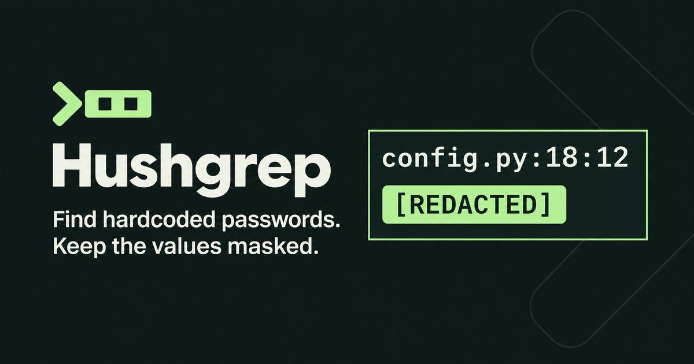

<p align="center">
  
</p>

# Hushgrep

Hushgrep scans a local Git working tree for hardcoded credentials, with a focus on ordinary passwords in configuration, connection strings and HTTP Basic auth. It reports file and line coordinates and replaces the matched values with [REDACTED]. It runs locally on CPU and disables live credential verification.

## GitHub Actions

Save this as `.github/workflows/hushgrep.yml` and run it from the **Actions** tab.

```yaml
name: Hushgrep
on:
  workflow_dispatch:
permissions:
  contents: read
jobs:
  scan:
    runs-on: ubuntu-24.04
    steps:
      - uses: actions/checkout@3d3c42e5aac5ba805825da76410c181273ba90b1 # v7.0.1
        with:
          persist-credentials: false
      - uses: beshkenadze/hushgrep@v0.1.0-alpha.5
```

Open the Action log to see the install phases and live scan counters. During inference, Hushgrep reports processed line windows per batch at roughly 15-second intervals. The counters contain neither paths nor values. The job summary includes scan coverage, time per stage and peak memory. Download the `hushgrep-report` artifact to view `report.html`, `report.json` and `metrics.json`. Artifacts are retained for seven days. Findings are candidates for review. A complete scan passes with findings. An incomplete scan uploads its partial report and fails.

Use the `path` input for a nested Git checkout and `artifact-name` for a different artifact name. The action downloads the Linux archive from the public release without a token and verifies its SHA-256. The Rust executable writes the reports and job summary.

## Linux CLI

Use **x86-64 Linux with glibc 2.39 or later** (for example Ubuntu 24.04), Git, libstdc++ and writable `/dev/shm`. Download the [archive](https://github.com/beshkenadze/hushgrep/releases/download/v0.1.0-alpha.5/hushgrep-linux-x86_64.tar.gz) and its [SHA-256 file](https://github.com/beshkenadze/hushgrep/releases/download/v0.1.0-alpha.5/hushgrep-linux-x86_64.tar.gz.sha256).

```sh
sha256sum -c hushgrep-linux-x86_64.tar.gz.sha256
tar -xzf hushgrep-linux-x86_64.tar.gz
./hushgrep-linux-x86_64/hushgrep --progress /path/to/repo --report-dir hushgrep-report
```

Use `--output findings.json` for a JSON-only file or omit both output flags to print JSON to stdout. Keep the executable alongside the bundled `model`, `lib` and `bin` directories. The compressed archive is about **310 MB** and the extracted bundle is about **378 MB**. The measured peak RSS was **1.32 GiB**. The scan of 1,806 lines took about **6 minutes** on a GitHub-hosted Ubuntu runner with two logical CPUs. Time and memory are measurements on that corpus.

## What the scanner reads

The scanner reads tracked and non-ignored untracked files from the current working tree. It skips history, submodule contents, ignored untracked files, symlinks, non-UTF-8 files, files over 1 MiB and files with lines longer than 4,096 characters. Reports count skipped files. File paths containing detected secret values are also masked.

The CPU pipeline combines v10 INT8, TruffleHog 3.99.9, and URI and HTTP Basic parsing. [Report format and native build instructions](native/README.md)

## Password benchmark

The corpus contains 12 complete authentication and parsing test files from 12 held-out projects. We scored 111 labelled password occurrences across 1,806 lines. An occurrence counts as found when a scanner range overlaps its label. Repeated values at different locations count separately. A distinct range counts as a false alert when it overlaps neither a labelled password nor another labelled credential.

| Scanner | Passwords found | Missed | False alerts | Scan time |
| --- | ---: | ---: | ---: | ---: |
| TruffleHog 3.99.9 | 32 | 79 | 4 | 1.39 s |
| Betterleaks 1.10.1 | 38 | 73 | 0 | 0.36 s |
| Prowl 1.5.0 (ML disabled) | 53 | 58 | 4 | 0.08 s |
| **Union of the three standalone scanners** | **73** | **38** | **8** | **1.83 s** |
| **Hushgrep v10 INT8 pipeline** | **84** | **27** | **22** | **359.74 s** |
| Union of all results | 93 | 18 | 26 | |

Hushgrep added 20 password occurrences in seven projects and 18 false alerts to the union of the three scanners. The three scanners found nine password occurrences the Hushgrep pipeline missed. Results are from GitHub-hosted Ubuntu 24.04 runners with two logical CPUs, using the frozen detector pipeline before the Action's report renderer moved to Rust. Peak RSS was 202 MiB for the sequential baseline and 1.32 GiB for Hushgrep. Times cover startup and scanning. Exact Hushgrep ranges varied across the two CPU environments tested. The selected files measure password detection in these fixtures.

### Run the three standalone scanners

Put [TruffleHog 3.99.9](https://github.com/trufflesecurity/trufflehog/releases/tag/v3.99.9), [Betterleaks 1.10.1](https://github.com/betterleaks/betterleaks/releases/tag/v1.10.1), [Prowl 1.5.0](https://github.com/Lercas/prowl/releases/tag/v1.5.0) and `jq` on your PATH. Run from Bash with the scanners' default configuration. These commands scan the directory offline and print per-scanner counts.

~~~bash
set -o pipefail
repo=/path/to/checkout

trufflehog filesystem "$repo" --concurrency 1 --no-verification --no-update --fail-on-scan-errors --json |
  jq -cn 'reduce inputs as $hit (0; . + 1) | {trufflehog: .}'

betterleaks dir "$repo" --redact=100 --no-color --no-banner --exit-code 0 --report-format json --report-path - |
  jq -c '{betterleaks: length}'

prowl scan "$repo" --format json --no-color --no-dedupe |
  jq -c '{prowl: .count, complete, truncated}'
~~~

These are counts before cross-scanner deduplication. The benchmark union merges identical source ranges, then scores the merged list against the same labels.

## Licenses

| Component | License |
| --- | --- |
| Hushgrep Rust CLI, GitHub Action and v10 fine-tuning contributions | [Apache-2.0](LICENSE) |
| v10 INT8 model | Derived from [Fastino GLiNER2.5 multi-v1](https://huggingface.co/fastino/gliner2.5-multi-v1) (Apache-2.0) and the [Microsoft mDeBERTa encoder](https://huggingface.co/microsoft/mdeberta-v3-base) (MIT) |
| Bundled ONNX Runtime 1.32.0 | [MIT](https://github.com/microsoft/onnxruntime/blob/v1.32.0/LICENSE) |
| Bundled TruffleHog 3.99.9 | [AGPL-3.0](licenses/TruffleHog-LICENSE). The release includes its [corresponding source archive](https://github.com/beshkenadze/hushgrep/releases/download/v0.1.0-alpha.5/trufflehog-3.99.9-source.tar.gz). |

See [NOTICE](NOTICE) and the license files bundled with the Linux archive. Fine-tuning used synthetic and labelled examples, including examples derived from [CredData](https://github.com/Samsung/CredData).
